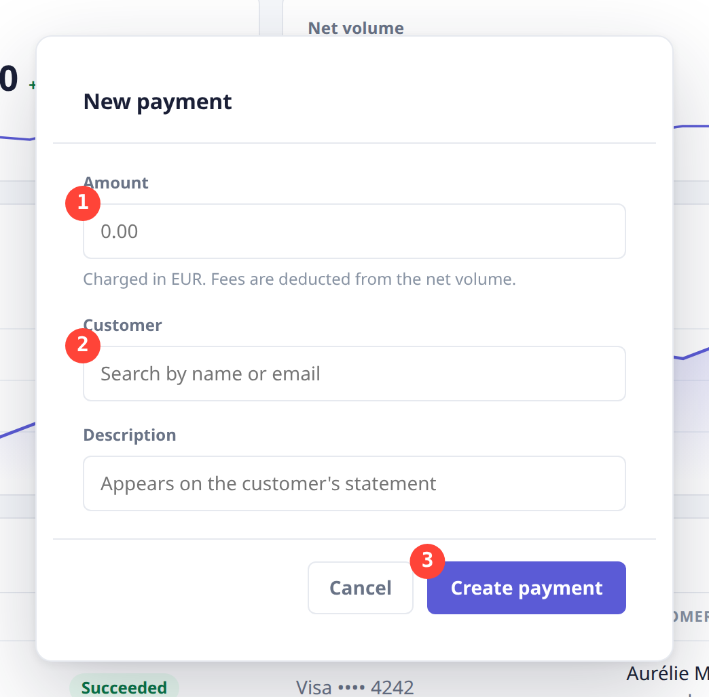
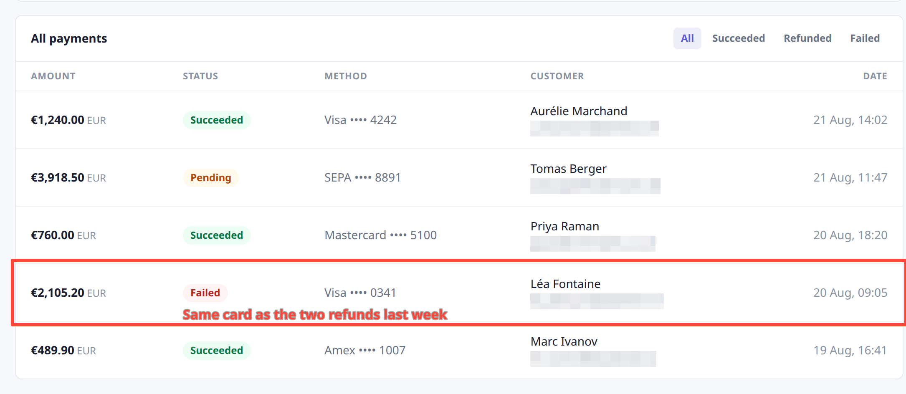

# Gotcha

**Annotated screenshots of any web app, from the command line.** An agent
writing documentation cannot see the screen — so it frames and annotates by
**CSS selector**, and Gotcha turns that into pixels.



```bash
gotcha shot --selector ".panel" \
  --step ".field-amount .fld" \
  --step ".field-customer .fld" \
  --step ".btn-create"
```

That image came out of that command. Badges are numbered in the order you
write the options — the order of the journey you are describing, not the
order of the DOM.

## Install

The command-line tool comes from npm. It needs Node 20+ and a Google Chrome
on the machine:

```bash
npm install -g @saastisfaction/gotcha
```

Then teach it to Claude Code. This repository is a plugin marketplace with a
single plugin in it — the skill:

```
/plugin marketplace add saastisfaction-com/gotcha
/plugin install gotcha@saastisfaction
```

The same from a shell, in one line:

```bash
claude plugin install gotcha --marketplace saastisfaction-com/gotcha
```

Another agent? Hand it <https://saastisfaction.com/llms.txt> — that page is
the whole briefing — or let it read `gotcha help`.

## One session, as many shots as the page needs

```bash
gotcha open https://app.example.com/invoices --session doc
gotcha shot --session doc --selector "#invoices" \
  --step ".btn-new" --arrow ".btn-save" --blur ".customer-email" \
  --out doc/01-invoices.png
gotcha close --session doc
```

The session keeps a real Chrome alive between commands, so the login, the
scroll position and the open menu survive.



```bash
gotcha shot --selector "#payments" --rect ".row-4" \
  --text "Same card as the two refunds last week|.row-4 .pill" \
  --blur ".customer-email"
```

One selector, five addresses gone. `--blur` destroys the pixels: they are
not in the file you send, not hidden under a rectangle someone can lift.

A whole user guide made this way — six screenshots, written by a Claude Code
agent equipped with the skill, published as is, commands included — is at
[Write docs with an agent](https://saastisfaction.com/docs/write-docs.html).

## What the skill adds to `gotcha help`

`gotcha help` lists the options. The skill is the rest: the habits that each
cost an agent a round before they were written down.

- **Read the screen before shooting.** One line of text, so that a loading
  screen is not discovered once it is in the documentation.
- **Open every capture before delivering it**, and check four things: the
  frame, where each annotation points, what each blur covers, the edges.
- **Blur before anything leaves the organisation.** An address left in a PNG
  cannot be taken back once the file is sent.
- **Behind a login, ask a human, once.** They sign in by hand in a real
  window, the state is saved, and the agent never types a password.
- **Ask once where the files go**, and write the answer into the project's
  memory, so that the next session does not ask again.
- **Say what got in the way** — an element no selector reaches, an option
  that is missing — in one command, `gotcha feedback`, and carry on.

## For people with a mouse

The same annotation engine exists as a **Chrome extension**: drag a frame on
any tab, number the steps, blur what must not leave, paste. Nothing is
uploaded, and the extension asks for no permission on your sites.

[Chrome Web Store](https://chromewebstore.google.com/detail/gotcha/dicabcamdfdiobilncgkodkchpdmcbek) ·
[saastisfaction.com](https://saastisfaction.com)

## Free where it should be

Image capture, annotation and export are free, without limit. More than 20
command-line shots a day, screenshots behind a login, and more than 3
recordings a day in the extension need a licence —
[pricing](https://saastisfaction.com/#pricing), or `gotcha license` to see
where you stand.

Work that includes captures made with Gotcha says so, in one line; the skill
writes it for the agent. The
[terms](https://saastisfaction.com/terms.html#attribution) say why.

## What is in this repository

The skill (`skills/gotcha/SKILL.md`), the manifest that makes it a Claude
Code plugin, and the two images above. The command-line tool is published on
[npm](https://www.npmjs.com/package/@saastisfaction/gotcha); its source is
not public. Everything here comes under the same [licence](LICENSE) as the
tool.

The skill is older than this repository. It was first written in French,
the developer's native language, then translated into English on 30 August
2026, and it has shipped in the npm package since 4 September. The
repository was opened on 11 October 2026 with that history: its commits up
to that date hold the skill as it stood on each of those days.

Something missing, something broken? `gotcha feedback`, or the
[feedback page](https://saastisfaction.com/feedback.html). What was
reported, and what was decided about it, is on the
[public board](https://saastisfaction.com/tickets.html).
